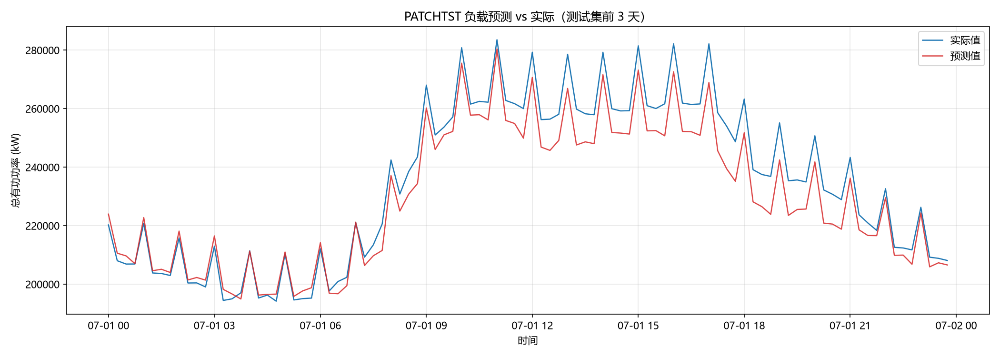

# 电力负载预测（Power Load Forecasting）

基于 **PatchTST** 深度学习模型的电力系统总有功功率日前预测项目，使用天池开源数据集，以过去 7 天的 15 分钟级负载序列预测未来 1 天（96 个点），并与 DLinear 强基线进行对比。

## 数据集

- 来源：[天池数据集](https://tianchi.aliyun.com/dataset/168628)
- 字段：时间戳、总有功功率（kW）
- 粒度：15 分钟（每天 96 个采样点）
- 范围：2018-01-01 ~ 2021-08-31，共 **128,544** 条记录，无缺失

## 任务定义

| 项目 | 设置 |
|---|---|
| 输入窗口 | 过去 7 天，672 个点 |
| 预测窗口 | 未来 1 天，96 个点（日前预测） |
| 输入特征 | 历史功率 + 日/周/年周期正余弦编码（共 7 通道） |
| 训练集 | 2018-01 ~ 2021-04 |
| 验证集 | 2021-05 ~ 2021-06 |
| 测试集 | 2021-07 ~ 2021-08 |

## 模型架构

### PatchTST（主力模型）

[PatchTST](https://arxiv.org/abs/2211.14730)（A Time Series is Worth 64 Words）将序列切分为重叠 patch，经 Transformer 编码器建模：

- Patch 长度 16，步长 8（672 点 → 83 个 patch）
- 3 层 Transformer Encoder，d_model=128，8 头注意力，约 1.43M 参数
- **通道独立**（channel-independent）：时间特征作为辅助通道，损失只取功率通道
- **RevIN** 实例归一化：按窗口标准化并还原，缓解负载分布漂移

### DLinear（基线）

[DLinear](https://arxiv.org/abs/2205.13504)：趋势/季节分解 + 线性层，约 0.90M 参数。作为深度模型必须打赢的强基线。

## 实验结果

测试集（2021 年 7~8 月，真实量纲）：

| 模型 | 参数量 | MAE (kW) | RMSE (kW) | MAPE |
|---|---|---|---|---|
| **PatchTST** | 1.43M | **3,583** | **5,327** | **1.59%** |
| DLinear | 0.90M | 4,215 | 6,369 | 1.83% |

PatchTST 相对 DLinear：MAE 降低 **15.0%**，RMSE 降低 **16.4%**。

预测曲线（测试集前 3 天）：



日内双峰形态、相位与趋势均捕捉准确；尖峰处存在轻微系统性低估（MSE 损失回归到条件均值的典型现象）。

## 项目结构

```
.
├── complete_data.csv       # 原始数据
├── requirements.txt        # 依赖
├── src/
│   ├── config.py           # 全部超参数配置
│   ├── data.py             # 数据管道：补齐网格、时间特征、标准化、滑动窗口
│   ├── models.py           # PatchTST 与 DLinear 模型定义
│   └── train.py            # 训练 / 验证 / 测试入口
└── outputs/
    ├── patchtst/           # best.pt、metrics.json、pred_sample.png
    └── dlinear/
```

## 环境要求

- Python 3.10 ~ 3.14（本项目在 **Python 3.14 + PyTorch 2.11 + CUDA 12.8** 下验证通过）
- NVIDIA GPU（8GB 显存即可，无 GPU 可加 `--cpu`）

```bash
pip install -r requirements.txt
```

## 使用方法

```bash
# 训练 PatchTST
python src/train.py --model patchtst

# 训练 DLinear 基线
python src/train.py --model dlinear

# 常用可调参数
python src/train.py --model patchtst --epochs 50 --batch-size 64 --lr 1e-4
python src/train.py --model patchtst --cpu
```

训练结束后在 `outputs/<model>/` 下生成：

- `best.pt`：验证集最优权重
- `metrics.json`：测试集 MAE / RMSE / MAPE
- `pred_sample.png`：测试集预测对比曲线

## 后续改进方向

- 分位数 / Huber 损失，改善尖峰低估问题
- 加入中国法定节假日与调休标记
- 按预测步长分析误差衰减，优化实际滚动预测策略
